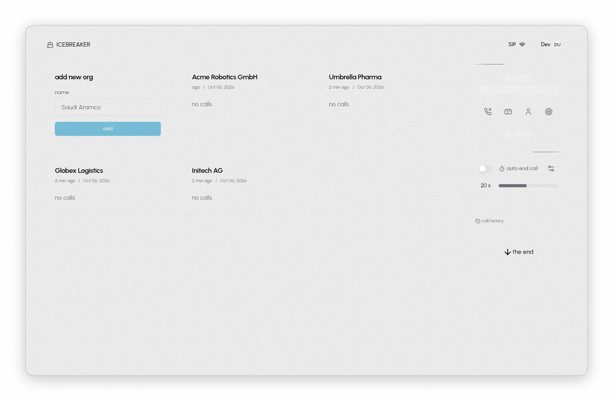
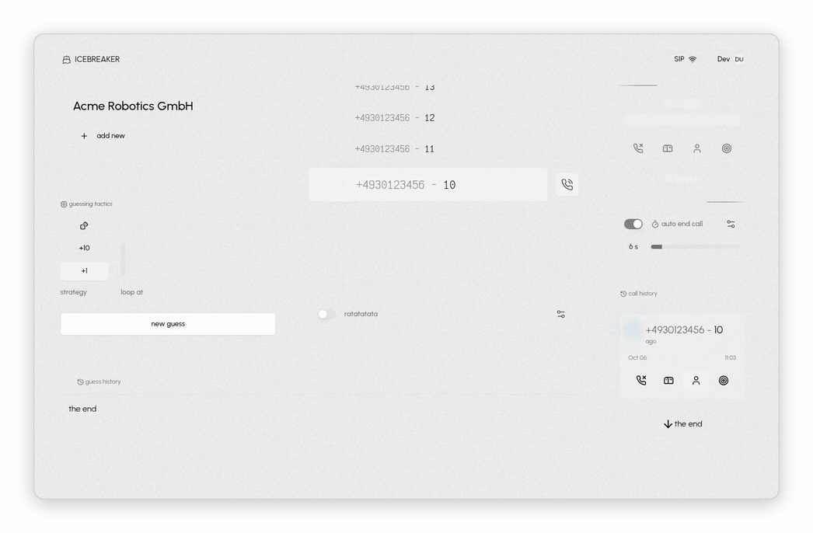
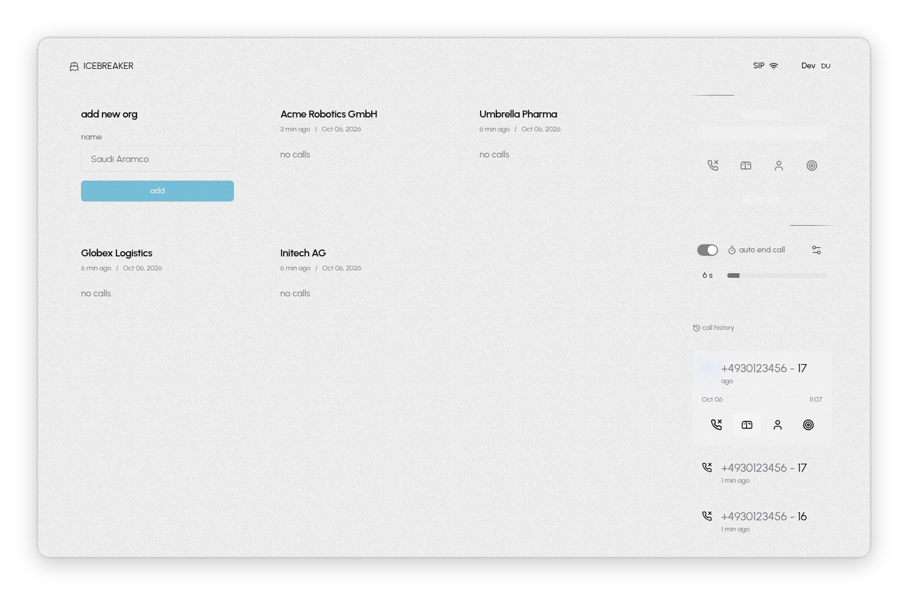
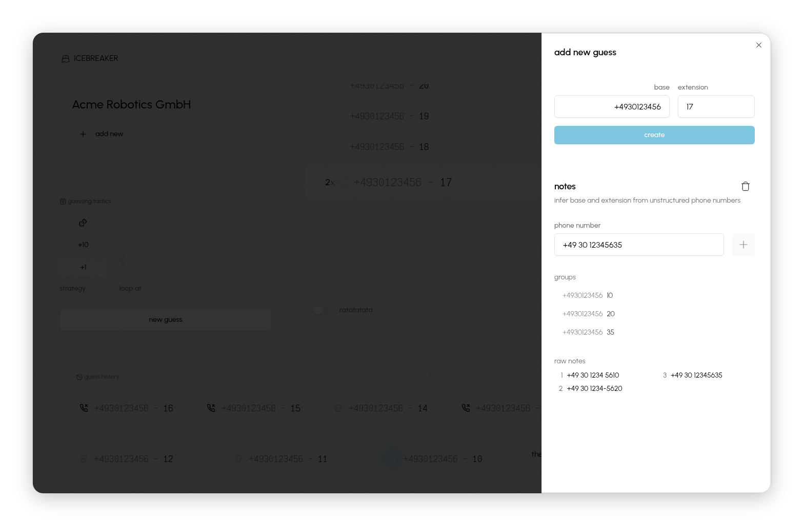
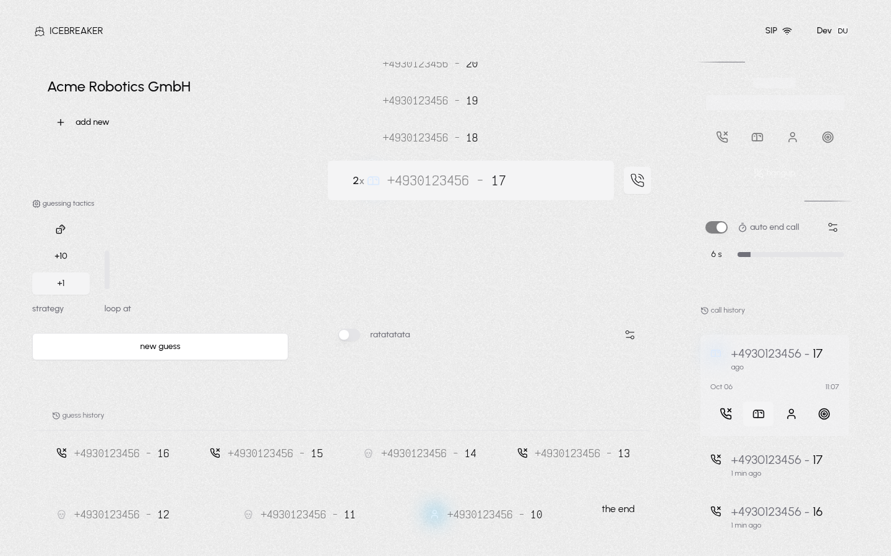
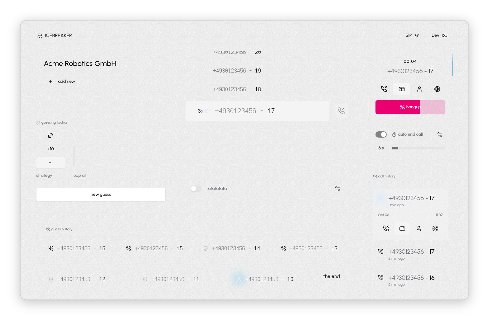
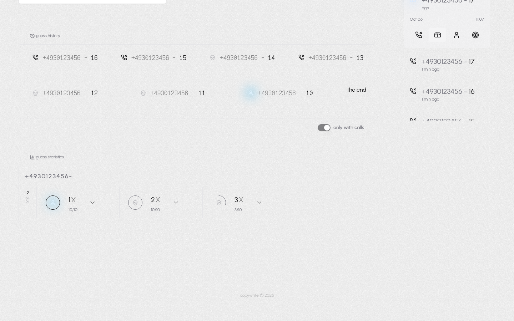

<p align="center">
  <picture>
    <source media="(prefers-color-scheme: dark)" srcset="docs/media/logo-dark.svg">
    
  </picture>
</p>

<p align="center">
  <picture>
    <source media="(prefers-color-scheme: dark)" srcset="docs/media/tag-dark.svg">
    
  </picture>
</p>

<p align="center">
  Find the direct extensions at a company that actually work, past the switchboard and the hotlines.<br>
  Icebreaker dials <code>base + extension</code> guesses through a SIP account, lets you rate every call, and learns which ranges of numbers reach a real person.
</p>

> [!CAUTION]
> **Experimental software. Not production ready.**
>
> Icebreaker is an experiment. It is incomplete, largely untested and may change or break at any time without notice. It is not intended, designed or supported for production use or for any commercial, business-critical or large-scale purpose.
>
> - **It places real phone calls.** Every call goes out through your own SIP account, is billed to you and reaches real people. Bugs can cause calls to be placed, repeated or ended unexpectedly.
> - **You are solely responsible for every call.** Telephone sales and outreach are regulated in most countries. In Germany, for example, calls to businesses for sales purposes require at least presumed consent (§7 UWG), calls to private persons require prior express consent, and your caller ID must not be suppressed (§120 TKG). Know and follow the rules that apply to you before you dial a single number.
> - **Respect the people you call.** Always show your caller ID, never call anyone who has asked you not to, and stop immediately if you are unsure whether a call is allowed.
> - **Your data is your responsibility.** Phone numbers, notes and call ratings can be personal data under the GDPR and similar laws. You are the controller of anything you store and must have a legal basis for it.
> - **No affiliation.** This project is not affiliated with, endorsed by or supported by sipgate or any other telephony provider. Using it may violate your provider's terms of service.
>
> This software is provided "as is", without warranty of any kind, express or implied. The authors and contributors accept no liability for any damages, costs, fines, legal claims or other consequences arising from its use or misuse. Nothing in this repository is legal advice. If you are not sure whether your use is lawful, do not use it.

<p align="center">
  <picture>
    <source media="(prefers-color-scheme: dark)" srcset="docs/media/flow-dark.gif">
    
  </picture>
</p>

## How it works

1. **Add an org** and give it a base number.
2. **Paste the numbers you already know** (from a website, an email signature, a business card). Icebreaker splits them into base and extension and suggests where to start guessing.
3. **Call.** Each guess is dialed over SIP. Rate the result: no answer, mailbox, a person, or the person you were looking for.
4. **Let it run.** Pick a strategy (`+1`, `+10` or random) and turn on **ratatatata** to dial guess after guess, ending each call automatically after a few seconds.
5. **Read the stats** to see which ranges of extensions reach real people, and which are dead, mailboxes or hotlines.

<p align="center">
  <picture>
    <source media="(prefers-color-scheme: dark)" srcset="docs/media/ratatatata-dark.gif">
    
  </picture>
</p>

## Screenshots

<table>
  <tr>
    <td width="50%">
      <picture>
        <source media="(prefers-color-scheme: dark)" srcset="docs/media/02-orgs-dark.png">
        
      </picture>
      <p align="center"><b>Orgs</b>: one board per company</p>
    </td>
    <td width="50%">
      <picture>
        <source media="(prefers-color-scheme: dark)" srcset="docs/media/03-number-inference-dark.png">
        
      </picture>
      <p align="center"><b>Number inference</b>: base and extension from raw notes</p>
    </td>
  </tr>
  <tr>
    <td width="50%">
      <picture>
        <source media="(prefers-color-scheme: dark)" srcset="docs/media/04-guesser-dark.png">
        
      </picture>
      <p align="center"><b>Guesser</b>: strategy, guess history and call log</p>
    </td>
    <td width="50%">
      <picture>
        <source media="(prefers-color-scheme: dark)" srcset="docs/media/05-live-call-dark.png">
        
      </picture>
      <p align="center"><b>Live call</b>: rate it while it rings</p>
    </td>
  </tr>
  <tr>
    <td width="50%">
      <picture>
        <source media="(prefers-color-scheme: dark)" srcset="docs/media/06-stats-dark.png">
        
      </picture>
      <p align="center"><b>Statistics</b>: outcomes per base number</p>
    </td>
  </tr>
</table>

## Local development (no Supabase, Google or sipgate)

Everything runs on this machine. Postgres 16 stands in for Supabase, a "dev sign in" button stands in for Google, and Asterisk stands in for sipgate as a fake phone network. It has no trunk, so no real call can be placed.

```bash
cp .env.localdev.example .env
pnpm localdev        # terminal 1: Postgres, ws proxy, Asterisk (needs nix; Ctrl-C stops all)
pnpm db:push         # once, and after schema changes
pnpm dev             # terminal 2
```

Then open <http://localhost:3000>, click **dev sign in** (you become `dev@example.com`), open the **SIP** button and log in with `dev` / `dev` (or `dev2` / `dev2`).

The **last digit** of the dialed number decides what the fake network does (see `tooling/localdev/asterisk/extensions.conf`):

| last digit | outcome                                                     |
| ---------- | ----------------------------------------------------------- |
| 0, 5-9     | rings 3s, answers, echoes your microphone until you hang up |
| 1          | busy (486)                                                  |
| 2          | rings 30s, nobody answers                                   |
| 3          | answers, beeps for 10s, then the other side hangs up        |
| 4          | network failure (503)                                       |

How it fits together:

- **DB**: the app talks to Postgres through `@vercel/postgres`, which uses WebSockets (needed for the edge runtime). `tooling/localdev/ws-proxy.js` forwards those to local Postgres on port 54322. `POSTGRES_WS_PROXY` turns this on in `packages/db/src/client.ts`. Data lives in `.localdev/` (delete it to reset).
- **Auth**: `AUTH_DEV_LOGIN=true` enables `/api/dev/sign-in`, which creates a normal database session. It is always off when `NODE_ENV=production`.
- **SIP**: `NEXT_PUBLIC_SIP_WS_URL` and `NEXT_PUBLIC_SIP_DOMAIN` choose the SIP server. They default to sipgate. `NEXT_PUBLIC_SIP_ICE_SERVERS` lists STUN/TURN servers (default: Google STUN); localdev sets it empty, because an unreachable STUN server delays every call by about 5 seconds. Asterisk CLI: `asterisk -C $PWD/.localdev/asterisk/etc/asterisk.conf -rvvv`.
- **Opening the app from another machine**: browsers only allow microphone access on `https` or `localhost`. Forward port 3000 and port 8088 to your machine's localhost. Asterisk sends call audio over UDP 10000-10100 straight to the container's IP, so those ports must be reachable too.
