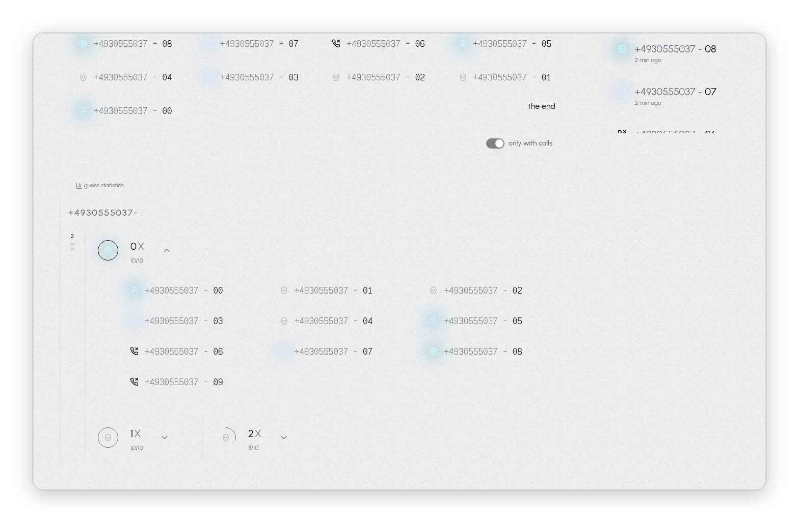

<p align="center">
  <picture>
    <source media="(prefers-color-scheme: dark)" srcset="docs/media/logo-dark.svg">
    
  </picture>
</p>

<p align="center">
  <picture>
    <source media="(prefers-color-scheme: dark)" srcset="docs/media/tag-dark.svg">
    
  </picture>
</p>

Icebreaker is a tool that finds working phone numbers at a company. Enter a few numbers you already know, such as hotlines. Icebreaker then calls other numbers at the company, one after another, using different strategies. After each call you note what happened: a person answered, it went to a mailbox, or nobody picked up. From these results Icebreaker shows which ranges of numbers reach people, so you know which numbers to call.

> [!CAUTION]
> **Experimental software that places real, billed phone calls.** You are responsible for every call and for following the law where you live. Read [Legal and safety](#legal-and-safety) before you dial a single number.

https://github.com/user-attachments/assets/5ba0807f-5321-4a79-ac02-286b45c117f1

## How it works

1. **Add an org** for the company.
2. **Enter the numbers you already know**, such as hotlines or numbers from a website or an email signature. Icebreaker suggests which numbers to call first.
3. **Call.** Each guess is dialed over SIP. Rate the result: no answer, mailbox, a person, or the person you were looking for.
4. **Let it run.** Pick a strategy (`+1`, `+10` or random) and turn on **ratatatata** to dial guess after guess, ending each call automatically after a few seconds.
5. **Read the stats** to see which ranges of numbers reach people, and which are dead, mailboxes or hotlines.

## Screenshots

<table>
  <tr>
    <td width="50%">
      <picture>
        <source media="(prefers-color-scheme: dark)" srcset="docs/media/02-orgs-dark.png">
        
      </picture>
      <p align="center"><b>Orgs</b>: one board per company</p>
    </td>
    <td width="50%">
      <picture>
        <source media="(prefers-color-scheme: dark)" srcset="docs/media/03-number-inference-dark.png">
        
      </picture>
      <p align="center"><b>Number inference</b>: base and extension from raw notes</p>
    </td>
  </tr>
  <tr>
    <td width="50%">
      <picture>
        <source media="(prefers-color-scheme: dark)" srcset="docs/media/04-guesser-dark.png">
        
      </picture>
      <p align="center"><b>Guesser</b>: strategy, guess history and call log</p>
    </td>
    <td width="50%">
      <picture>
        <source media="(prefers-color-scheme: dark)" srcset="docs/media/05-live-call-dark.png">
        
      </picture>
      <p align="center"><b>Live call</b>: rate it while it rings</p>
    </td>
  </tr>
  <tr>
    <td width="50%">
      <picture>
        <source media="(prefers-color-scheme: dark)" srcset="docs/media/06-stats-dark.png">
        
      </picture>
      <p align="center"><b>Statistics</b>: outcomes per base number</p>
    </td>
    <td width="50%">
      <picture>
        <source media="(prefers-color-scheme: dark)" srcset="docs/media/07-stats-expanded-dark.png">
        
      </picture>
      <p align="center"><b>Statistics, expanded</b>: every number in a range and its result</p>
    </td>
  </tr>
</table>

## Tech stack

- **App**: Next.js, React, tRPC, TanStack Query, Tailwind with Radix UI
- **Data**: Postgres on Supabase, Drizzle ORM
- **Auth**: Auth.js with Google sign-in
- **Calls**: SIP.js in the browser, SIP over WebSocket
- **Hosting**: Vercel

## Local development

Each production service has a local stand-in:

- **Data**: Postgres 16 instead of Supabase. `@vercel/postgres` connects over WebSockets, so `tooling/localdev/ws-proxy.js` forwards them to port 54322 (`POSTGRES_WS_PROXY`). Data lives in `.localdev/`; delete it to reset.
- **Auth**: a **dev sign in** button instead of Google (`AUTH_DEV_LOGIN=true`, always off in production).
- **Calls**: Asterisk instead of a real SIP provider (`NEXT_PUBLIC_SIP_WS_URL`, `NEXT_PUBLIC_SIP_DOMAIN`). Any provider with SIP over WebSocket works in production. `NEXT_PUBLIC_SIP_ICE_SERVERS` lists STUN/TURN servers (default: Google STUN); localdev sets it empty, because an unreachable STUN server delays every call by about 5 seconds.

```bash
cp .env.localdev.example .env
pnpm localdev        # terminal 1: Postgres, ws proxy, Asterisk (needs nix; Ctrl-C stops all)
pnpm db:push         # once, and after schema changes
pnpm dev             # terminal 2
```

Then open <http://localhost:3000>, click **dev sign in** (you become `dev@example.com`), open the **SIP** button and log in with `dev` / `dev` (or `dev2` / `dev2`).

The **last digit** of the dialed number decides what the fake network does (see `tooling/localdev/asterisk/extensions.conf`):

| last digit | outcome                                                     |
| ---------- | ----------------------------------------------------------- |
| 0, 5-9     | rings 3s, answers, echoes your microphone until you hang up |
| 1          | busy (486)                                                  |
| 2          | rings 30s, nobody answers                                   |
| 3          | answers, beeps for 10s, then the other side hangs up        |
| 4          | network failure (503)                                       |

Asterisk CLI: `asterisk -C $PWD/.localdev/asterisk/etc/asterisk.conf -rvvv`.

**Opening the app from another machine**: browsers only allow the microphone on `https` or `localhost`. Forward ports 3000 and 8088 to your localhost, and make UDP 10000-10100 on the container's IP reachable for call audio.

## Legal and safety

Icebreaker is an experiment. It is incomplete, largely untested and may change or break at any time without notice. Use it for small personal experiments only.

- **It places real phone calls.** Every call goes out through your own SIP account, is billed to you and reaches real people. Bugs can cause calls to be placed, repeated or ended unexpectedly.
- **You are solely responsible for every call.** Telephone sales and outreach are regulated in most countries. In Germany, for example, calls to businesses for sales purposes require at least presumed consent (§7 UWG), calls to private persons require prior express consent, and your caller ID must not be suppressed (§120 TKG). Know and follow the rules that apply to you before you dial a single number.
- **Respect the people you call.** Always show your caller ID, never call anyone who has asked you not to, and stop immediately if you are unsure whether a call is allowed.
- **Your data is your responsibility.** Phone numbers, notes and call ratings can be personal data under the GDPR and similar laws. You are the controller of anything you store and must have a legal basis for it.
- **Independent project.** Icebreaker is an independent project, separate from every telephony provider. Using it may violate your provider's terms of service.

This software is provided "as is", without warranty of any kind, express or implied. The authors and contributors accept no liability for any damages, costs, fines, legal claims or other consequences arising from its use or misuse. If you are unsure whether your use is lawful, stop and get legal advice first.

## License

Icebreaker is open source under the [MIT License](LICENSE). You may use, copy, modify and distribute it freely.
